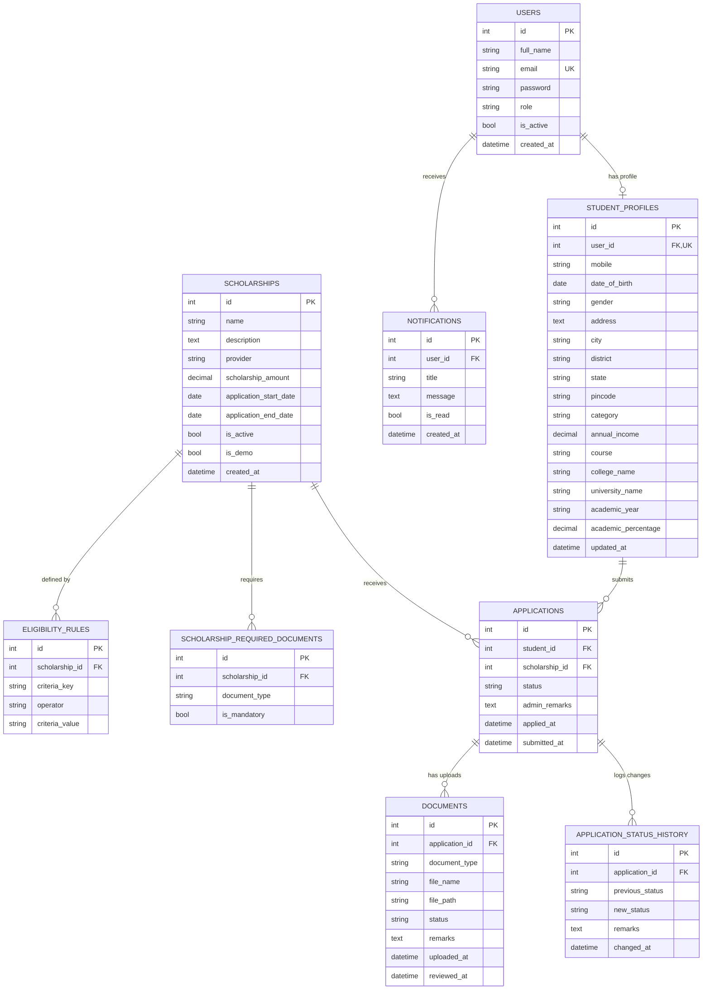
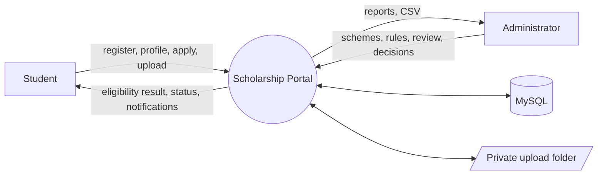
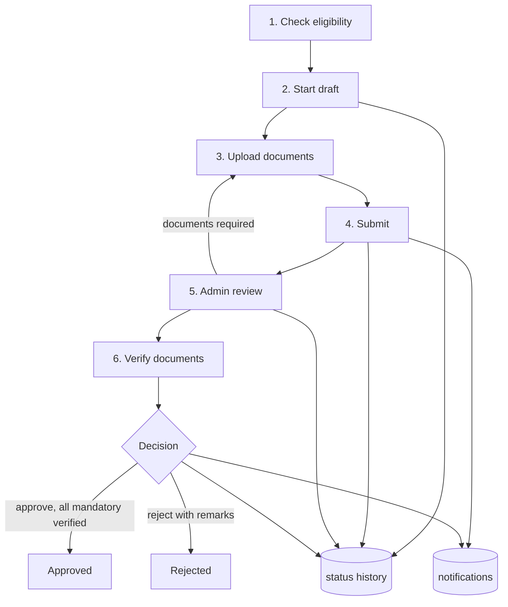

# Database Design

Database: MySQL 8 (utf8mb4). Schema is managed by Flask-Migrate; the current Alembic head is `a483282816d0`.

## Tables

| Table | Purpose | Key constraints |
|---|---|---|
| `users` | Login accounts for students and administrators | `email` unique; `role` is `student` or `admin` |
| `student_profiles` | One profile per student: personal, category, income, education | `user_id` unique (one-to-one with `users`) |
| `scholarships` | Scheme definitions, amount, dates, active flag, `is_demo` flag | — |
| `eligibility_rules` | Configurable rules: one row per criterion per scheme | FK → `scholarships` |
| `scholarship_required_documents` | Which document types a scheme needs and whether each is mandatory | unique (`scholarship_id`, `document_type`) |
| `applications` | A student's application to a scheme, with status and reference data | unique (`student_id`, `scholarship_id`); indexes on `student_id`, `scholarship_id`, `status` |
| `documents` | Uploaded files for an application: type, stored path, review status and remarks | FK → `applications`; index on `application_id` |
| `application_status_history` | Append-only log of every status change | FK → `applications` |
| `notifications` | In-app messages for a user, with read flag | FK → `users`; index on `user_id` |
| `alembic_version` | Migration bookkeeping | — |

## Relationships

- `users` 1 — 0..1 `student_profiles`
- `scholarships` 1 — * `eligibility_rules`
- `scholarships` 1 — * `scholarship_required_documents`
- `student_profiles` 1 — * `applications` and `scholarships` 1 — * `applications`, with one application per student per scheme
- `applications` 1 — * `documents`
- `applications` 1 — * `application_status_history`
- `users` 1 — * `notifications`

## ER diagram

## Status values

- Application: `draft`, `submitted`, `under_review`, `documents_required`, `approved`, `rejected`.
  Allowed transitions are defined in `services/constants.py` (`APPLICATION_TRANSITIONS`).
- Document: `pending`, `verified`, `rejected`, `resubmission_required`.

## Monetary and date fields

Amounts and income use `DECIMAL` (`scholarship_amount` 12,2; `annual_income` 12,2; `academic_percentage` 5,2). Timestamps are stored as UTC `DATETIME`.

## Migration history

| Revision | Description |
|---|---|
| `cb423ab850f5` | Sync `student_profiles` with the model: add 8 columns, drop unused `domicile_state` (all NULL in existing data) |
| `a483282816d0` | Add `notifications`, `scholarship_required_documents`, `applications.submitted_at`, `documents.status/remarks/reviewed_at`, `scholarships.is_demo`, and indexes |

Both revisions were applied to the development database. Schema drift check after applying: 0 differences between models and tables.

## Data flow (level 0 → level 1)

Level 1 detail for the application process:

